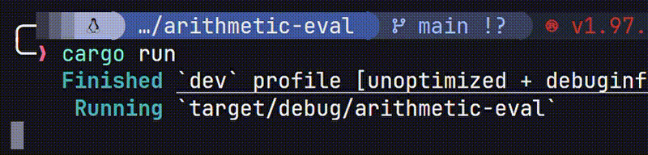

#### Arithmetic expressions parser and evaluator

This is a project I made to learn more about parsing and how context free grammars can be parsed, before I try create a parser for a real language. I know this can be solved by different simpler ways, or eliminating more recurtion where iteration is simpler, but I kept it like that to match the actual grammar in grammar.txt.

It maintains correctly the precedency order and associativity rules of different operations.

### Quick Demo

